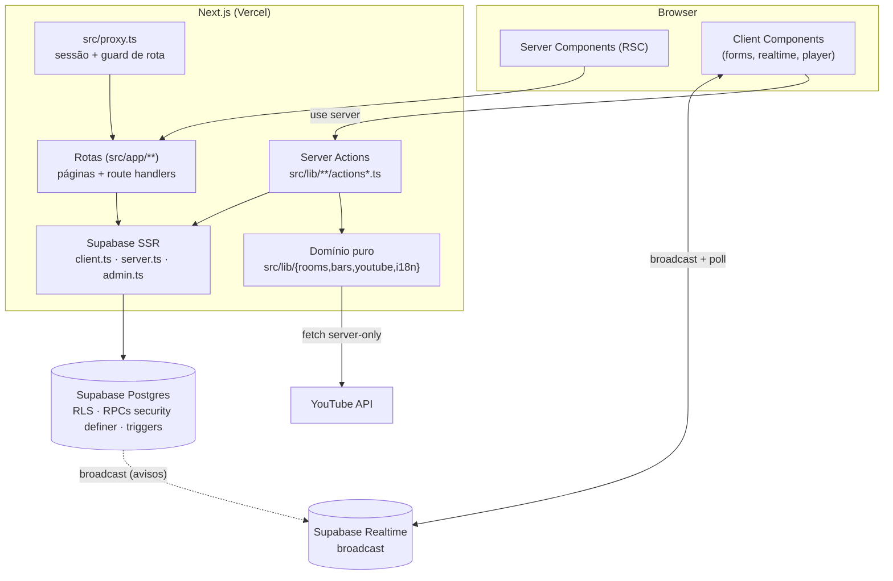

# Arquitetura — Karaokê Watch Party

> Documento de referência da arquitetura **real** do código. Ele descreve as
> camadas, os contratos entre elas e **onde mexer** em cada tipo de mudança.
> Complementa — não substitui — os ADRs em [`../decisions/`](../decisions/) e os
> fluxos em [`../flows/`](../flows/).

## 1. Resumo em uma frase

Um app **Next.js 16 (App Router)** server-first, com **Supabase/Postgres** como
backend de verdade (regras, autorização e consistência moram no banco) e uma
camada de **realtime leve** (broadcast + poll + refetch no foco) para fila e
playback. Mobile-first para o público, TV em modo quiosque para a casa.

## 2. Stack e por quê

| Camada | Escolha | Motivo |
| --- | --- | --- |
| Framework | **Next.js 16** (App Router, RSC, Server Actions) | server-first sem API própria; rota + dados no mesmo lugar |
| Linguagem | **TypeScript** `strict`, alias `@/*` → `src/*` | domínio tipado; refactor seguro |
| UI | **React 19** + **Tailwind 4** + **shadcn/ui** (Radix) | velocidade, acessibilidade, sem design system próprio |
| Estado client | **Zustand** (só `auth-store`) + React state | mínimo de estado global; servidor é a fonte |
| Validação | **zod** (schema por feature) | contrato de formulário/entrada |
| Backend | **Supabase** (Postgres + Auth + Realtime + RLS) | free tier; RLS como parede primária |
| Vídeo | **YouTube Data API** (busca) + **IFrame Player API** (playback) | [ADR-001](../decisions/ADR-001-youtube-first-vs-licensed-catalog.md) |
| Testes | **Vitest** + Testing Library + jsdom + **MSW** | rápido, sem rede real |

## 3. Camadas



**Regra de leitura:** o cliente nunca fala direto com o banco para *regra de
negócio*; ele chama **server action** ou lê via **RSC**. O acesso direto a tabela
via `supabase-js` existe para leitura simples, mas *toda* escrita sensível passa
pelo banco (RLS + RPC/trigger). Ver [ADR-003](../decisions/ADR-003-rls-as-primary-wall-plus-rpcs-security-definer.md).

## 4. Estrutura de pastas

```
src/
├─ app/                     # rotas (App Router)
│  ├─ layout.tsx            # raiz: fontes, tema, auth session, toaster
│  ├─ (app)/                # grupo protegido: layout faz o guard de sessão
│  ├─ player/[codigo]/      # TV (público por token), fora do grupo (app)
│  ├─ login / sobre /       # públicas
│  └─ api/youtube/**        # route handlers (server-only)
├─ components/              # UI: about, auth, bars, consent, onboarding,
│                           #     rooms, shared, shell, ui (shadcn)
├─ lib/                     # domínio + infra
│  ├─ rooms/                # fila, playback, entrada, realtime, hooks
│  ├─ bars/                 # presença/geo, QR, pulseira, schema
│  ├─ youtube/              # credenciais, busca, OAuth, cache, rate limit
│  ├─ supabase/             # client/server/admin
│  ├─ auth/ · consent/ · i18n/ · pix/
│  └─ app-url.ts · clipboard.ts · dev.ts · utils.ts
├─ stores/                  # Zustand (auth-store)
├─ types/                   # tipos de domínio (room, bar)
└─ test/                    # setup do Vitest + duplos (fake-youtube…)
supabase/migrations/        # SQL versionado (a fonte da verdade do backend)
scripts/                    # seed, apply-sql, smokes, scan-secrets, medições
docs/                       # produto, flows, decisions (ADRs), engenharia
```

## 5. Rotas

### Páginas

| Rota | Grupo | Guard |
| --- | --- | --- |
| `/` | raiz | pública |
| `/login`, `/sobre` | raiz | públicas |
| `/player/[codigo]` | raiz | TV: por **token** (sem login) ou por **sessão** (membro host) |
| `/entrar`, `/dashboard`, `/bar/[codigo]`, `/salas/[codigo]`, `.../buscar`, `.../sala`, `.../player`, `.../pulseiras` | `(app)` | **sessão** (layout) + `host_id`/`bars.host_id` nas rotas de config |

### Route handlers (`src/app/api`)

- `POST /api/youtube/search` — busca server-only com cadeia de credenciais.
- `GET /api/youtube/diagnostics` — relatório só-`dev` (opcionalmente gasta cota).
- `GET /auth/callback`, `/auth/youtube/{authorize,callback}` — OAuth (Supabase e
  YouTube por-host).

## 6. Autenticação e autorização

Há **três portas** de autorização, do mais externo ao mais interno:

1. **`src/proxy.ts`** (o antigo `middleware.ts`; Next 16 renomeou para `proxy`).
   Cuida de sessão/cookies e **guard de prefixos protegidos** (`PROTECTED_PREFIXES`,
   inclui `/bar`). Só roteia — não decide permissão de domínio.
2. **Layout do grupo `(app)`** (`src/app/(app)/layout.tsx`) — `createClient()` →
   `auth.getUser()` → `redirect("/login")`. É o guard de sessão de verdade das
   telas internas. Telas de host conferem `rooms.host_id`/`bars.host_id` na página.
3. **Banco** — a última e mais importante parede: **RLS** em todas as tabelas +
   **RPCs `security definer`** para o que precisa de privilégio + **triggers
   `BEFORE INSERT/UPDATE`** que fecham o caminho do `INSERT`/`UPDATE` direto via
   PostgREST (que a RLS sozinha deixaria passar por permissão de coluna). Ler
   [auditoria-rls.md](../engenharia/auditoria-rls.md) antes de mexer aqui.

**Segredos do host** (token do player, chave do YouTube) **nunca** vão ao cliente
em claro: ficam atrás de RPCs host-only (`admin_get_room_player_token`,
`admin_get_room_youtube_api_key`). A TV recebe o token pela URL; qualquer outro
aparelho usa a sessão.

**Anônimo é usuário Supabase de verdade** (id estável por navegador), mas nunca é
pré-aprovado e não resgata pulseira.

## 7. Acesso a dados

| Situação | Padrão | Onde |
| --- | --- | --- |
| Ler para renderizar | RSC com `createClient()` (SSR) | server components em `src/app/**` |
| Escrever / mutar | **Server Action** (`"use server"`) | `src/lib/**/*-actions.ts`, `actions.ts` |
| Operação privilegiada/atômica | RPC `security definer` | migrations + chamada na action |
| Bypass de RLS (jobs/admin) | `createAdmin()` (service role) | **só** em route handlers/server |
| Regra pura e testável | funções em `src/lib/**` (sem I/O) | `queue.ts`, `playback.ts`, `geo.ts`… |

Os **smokes SQL** (`scripts/smoke-*.sql`) provam o contrato do banco que os
testes unitários não alcançam. Toda migration relevante tem um.

## 8. Realtime

O realtime é **otimização de frescor**, não a fonte da verdade — o estado sempre
pode ser re-buscado. O desenho é deliberado para caber no free tier (ver
[limites-free-tier.md](../engenharia/limites-free-tier.md)):

- **Broadcast, não `postgres_changes`.** Avisos de mudança usam
  `channel.httpSend` (um `POST`), então quem avisa **não abre WebSocket**.
- **Canais por assunto**: `room-channel.ts` (fila), `player-channel.ts`
  (playback), `member-channel.ts` (membros), `visibility-channel.ts`
  (`subscribeWhileVisible` — desassina quando a aba fica oculta).
- **Poll + refetch no foco/visibilidade** como rede de segurança
  (`use-playback-live.ts`, `use-own-active-song.ts`).
- **Fan-out no banco**: triggers só emitem evento quando a linha **muda de fato**
  (`is distinct from`), e `touch_updated_at` cancela UPDATE idêntico.

> Próximo passo registrado: unificar os canais num único `room-<roomId>`
> (bloqueado pela migration `20261013000003`, que dá o `room.id` à TV).

## 9. Domínio (`src/lib`)

- **`rooms/`** — coração do produto: `queue.ts` (regras puras da fila,
  posições, teto, uma-ativa/no-stop), `queue-actions.ts` / `actions.ts` /
  `playback-actions.ts` (server actions), `entry-state.ts` (estado efetivo da
  entrada + pré-aprovação 24h), `spectator.ts` (permissão "ver mas não pedir"),
  `playback.ts`, `player-arm.ts` (gate humano da TV) e os hooks/canais realtime.
- **`bars/`** — `geo.ts` (# dentro/fora do raio), `presence.ts`, `qr.ts`
  (geração/leitura de QR), `pulseiras.ts` / `pulseira-actions.ts` (ingresso de
  uso único), `schema.ts` (zod).
- **`youtube/`** — `credentials.ts` (cadeia de credenciais + portão `is_dev`),
  `search.ts`/`service.ts`, `host-oauth.ts`/`app-oauth.ts`, `cache.ts`,
  `rate-limit.ts`, `errors.ts` (classificação do `reason` do Google),
  `diagnostics.ts`.
- **`i18n/`** — dicionários e helper de tradução (docs/UI em PT-BR).

**Princípio:** regra de negócio pura mora em `*.ts` **sem I/O**, com teste
unitário; o I/O (Supabase/YouTube) fica nas actions/handlers.

## 10. UI, estado e tema

- **shadcn/ui** em `components/ui` (style `radix-nova`, `rsc: true`); o helper
  `cn` vem de `"cn"` e é reexportado em `src/lib/utils.ts`.
- Componentes de feature em `components/{rooms,bars,auth,onboarding,shell,shared}`.
- **Zustand só para sessão** (`stores/auth-store.ts`); o resto é RSC + estado
  local + realtime.
- Tema claro/escuro via `next-themes`; toasts via `sonner`.

## 11. Banco e migrations

- Migrations em `supabase/migrations/`, nomeadas `YYYYMMDDHHMMSS_titulo.sql`,
  **imutáveis depois de aplicar**. O padrão do time é aplicar manualmente com
  `node scripts/apply-sql.mjs <arquivo>` (via Management API, no projeto remoto).
  **Nunca** `supabase db push`.
- **Multi-tenancy**: `bar_id`/`room_id` em toda tabela; RLS valida isolamento.
- **Consistência no banco**: `position` da fila sob advisory lock
  (`hashtextextended('karaoke_queue:'||room_id, 0)`), status derivado do modo da
  sala, playback com invariantes por trigger (`rooms_sync_playback`).
- Mudança de contrato de RPC: mantenha compatibilidade durante o rollout (ex.:
  a assinatura 2-arg de `reorder_queue` como invólucro da 3-arg na Fase 19) para
  não haver janela de quebra entre deploy do banco e do client.

## 12. Testes

| Nível | Ferramenta | Prova |
| --- | --- | --- |
| Unit/integração | Vitest + RTL + jsdom | regras puras, actions, componentes |
| Rede externa | MSW | route handlers do YouTube, sem rede real |
| Banco/RLS | **smoke SQL** (`scripts/smoke-*.sql`) | RLS, RPCs, triggers, invariantes |
| E2E | Playwright (pós-MVP) | player kiosk com IFrame mockada |

Detalhes e checklist por fase em [`../../TESTING.md`](../../TESTING.md).

## 13. Build, ambientes e deploy

- **Vercel**; `NEXT_PUBLIC_*` é **inlinado no build** — mudar env exige re-deploy
  (o caso clássico é `NEXT_PUBLIC_APP_URL`, base dos QRs).
- **CI** (`.github/workflows/ci.yml`): `scan:secrets`, `lint`, `typecheck`,
  `test`, `build` (e `format:check` não bloqueante).
- **Deploy de produção é manual** e confirmado pelo dono
  (`vercel deploy --prod`, alias `https://karaoke-flow.vercel.app`).
- **Ordem de rollout**: banco **antes** do client, sempre de forma compatível.

## 14. Onde mexer (mapa de decisão)

| Quero mudar… | Comece por… |
| --- | --- |
| Regra da fila/posições/teto | `src/lib/rooms/queue.ts` (+ `queue.test.ts`) e a trigger/RPC em `supabase/migrations/` |
| Permissão de pedir/entrar | `entry-state.ts` / `spectator.ts` + `member_entry_state` no banco |
| Playback da TV | `playback.ts`, `playback-actions.ts`, `player-arm.ts` + `set_playback`/`claim_next_queue_item` |
| Frescor em tempo real | canais em `src/lib/rooms/*-channel.ts` + `visibility-channel.ts` |
| Busca no YouTube / cota | `src/lib/youtube/*` + `src/app/api/youtube/**` |
| Presença/geo/QR/pulseira | `src/lib/bars/*` |
| Autorização/segurança | RLS/RPC/trigger (migration) + [auditoria-rls.md](../engenharia/auditoria-rls.md) |
| UI/tema/estilo | `src/components/**` + `globals.css` (fase de UX/UI) |
